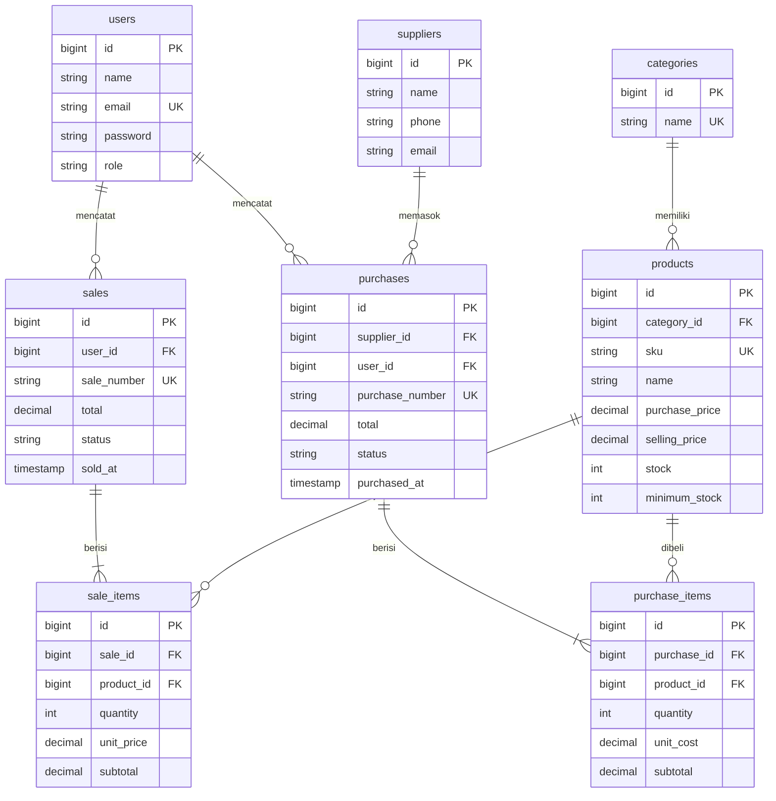

# Inventory & Sales Management System

Aplikasi web terintegrasi (Laravel + MySQL) untuk mengelola **master data**, **pembelian (stock-in)**, **penjualan**, dan **konsistensi stok**, dengan dua role: **Admin/Owner** dan **Staff**.
Dibuat untuk UTS Web Programming 2 — Integrated Laravel Project.

## 1. Project Overview

| Modul | Keterangan |
|---|---|
| Authentication | Login/logout, password di-hash (bcrypt), semua halaman dilindungi middleware `auth` |
| Master data | Kategori, Produk (SKU unik, harga, stok, minimum stok), Pemasok |
| Purchase | Header + banyak item; stok **bertambah** saat transaksi berhasil |
| Sales | Header + banyak item; stok **berkurang** hanya jika berhasil; stok kurang → ditolak |
| Dashboard | Total produk, penjualan hari ini/bulan ini, jumlah transaksi, produk stok rendah (query agregat dari DB) |
| Search & report | Cari SKU/nama, filter kategori, filter tanggal & status, pagination, detail transaksi |
| Pembatalan | Admin dapat membatalkan transaksi; stok dipulihkan secara konsisten |

## 2. Requirements

- PHP >= 8.2 (dengan ekstensi `pdo_mysql`, `mbstring`, `openssl`, `tokenizer`, `xml`, `ctype`, `json`)
- Composer 2
- MySQL 8 / MariaDB 10.6+
- Node.js 18+ dan npm (untuk `npm run build`)
- Laravel 11 atau 12

## 3. Installation

Repository ini berisi **lapisan aplikasi** (app, routes, views, migration, seeder, test) di atas skeleton Laravel resmi.

```bash
# 1. Buat project Laravel baru
composer create-project laravel/laravel inventory-sales
cd inventory-sales

# 2. Salin SELURUH isi folder repo ini ke root project (timpa file yang sudah ada)
#    File yang ditimpa: app/Models/User.php, app/Providers/AppServiceProvider.php,
#    routes/web.php, database/seeders/DatabaseSeeder.php, phpunit.xml, .env.example, README.md

# 3. Siapkan environment
composer install
cp .env.example .env
php artisan key:generate
```

> Jika repository ini sudah lengkap (sudah berisi skeleton Laravel), cukup jalankan langkah `composer install` dan seterusnya.

## 4. Environment Setup

1. Buat database kosong, contoh: `CREATE DATABASE inventory_sales CHARACTER SET utf8mb4 COLLATE utf8mb4_unicode_ci;`
2. Edit `.env`:

```
DB_CONNECTION=mysql
DB_HOST=127.0.0.1
DB_PORT=3306
DB_DATABASE=inventory_sales
DB_USERNAME=root
DB_PASSWORD=<password MySQL lokal Anda>
```

`.env` **tidak** di-commit (sudah ada di `.gitignore` bawaan Laravel). Yang di-commit hanya `.env.example`.

## 5. Migration & Seeding

```bash
php artisan migrate --seed
npm install
npm run build
php artisan serve
```

Buka http://localhost:8000. Seluruh tabel dibuat lewat migration (tidak bergantung pada database manual). Seeder menyiapkan 5 kategori, 3 pemasok, 12 produk (beberapa sengaja stok rendah), dan 2 akun demo. Seeder aman dijalankan ulang.

Menjalankan test (memakai SQLite in-memory, tidak menyentuh database MySQL):

```bash
php artisan test
```

## 6. Demo Account

Akun berikut hanya data dummy untuk demo (bukan kredensial pribadi):

| Role | Email | Password |
|---|---|---|
| Admin | admin@example.com | password |
| Staff | staff@example.com | password |

## 7. Features

- **Role & hak akses (server-side)** — Gate + middleware `can:`; menyembunyikan tombol di UI hanyalah tambahan.
  - Admin: kelola pengguna, CRUD kategori/produk/pemasok, lihat semua transaksi, dashboard, batalkan transaksi.
  - Staff: lihat produk, buat pembelian & penjualan, lihat transaksi miliknya sendiri. Akses URL admin → **403**.
- **Business rules**
  - SKU unik (validasi Laravel + unique index database).
  - Kuantitas > 0, harga >= 0 (validasi server).
  - Penjualan tidak boleh melebihi stok; stok tidak pernah negatif (cek aplikasi + kolom `unsigned` di DB).
  - Total & harga dihitung server dari database — input harga/total dari browser diabaikan.
  - Header, item, dan perubahan stok disimpan dalam satu `DB::transaction()`; satu item gagal → rollback semua.
  - `lockForUpdate()` pada baris produk mencegah overselling pada transaksi bersamaan; produk diproses berurutan `product_id` untuk menghindari deadlock.
  - Transaksi selesai tidak diedit; hanya bisa **dibatalkan** (stok dipulihkan). Pembatalan pembelian ditolak jika stok hasil pembelian itu sudah terpakai.
  - Produk/kategori/pemasok/pengguna yang sudah dipakai tidak bisa dihapus (larangan hapus + foreign key `RESTRICT`).
- **UI** — layout Blade reusable (Bootstrap 5 via CDN), navigasi, pesan sukses/error, input lama dipertahankan saat validasi gagal, form multi-item dinamis, responsive.
- **Keamanan dasar** — CSRF (`@csrf`), escaping output (`{{ }}`), password hashing, rate-limit login, mass-assignment protection (`$fillable`), query berparameter.

## 8. ERD



Kolom tambahan di luar skema minimal: `cancelled_at` dan `cancelled_by` pada `purchases`/`sales` untuk jejak pembatalan.

### Relasi Eloquent

| Model | Relasi |
|---|---|
| Category | `hasMany(Product)` |
| Product | `belongsTo(Category)`, `hasMany(SaleItem)`, `hasMany(PurchaseItem)` |
| Supplier | `hasMany(Purchase)` |
| Purchase | `belongsTo(Supplier)`, `belongsTo(User)`, `hasMany(PurchaseItem)` |
| PurchaseItem | `belongsTo(Purchase)`, `belongsTo(Product)` |
| Sale | `belongsTo(User)`, `hasMany(SaleItem)` |
| SaleItem | `belongsTo(Sale)`, `belongsTo(Product)` |
| User | `hasMany(Sale)`, `hasMany(Purchase)` |

`hasMany` dipasang di sisi "satu" (mis. satu Sale punya banyak SaleItem), `belongsTo` di sisi "banyak". Foreign key (`sale_id`) berada di tabel detail karena satu sel tidak dapat menyimpan banyak nilai — tiap baris item menunjuk ke induknya.

## 9. Struktur Kode Inti

```
Route (routes/web.php) → Middleware (auth, can:) → Controller
   → Form Request (validasi) → Service (business logic + DB::transaction)
   → Eloquent Model → MySQL → Blade
```

| Lokasi | Isi |
|---|---|
| `app/Services/SaleService.php` | Logika penjualan & pembatalan |
| `app/Services/PurchaseService.php` | Logika pembelian & pembatalan |
| `app/Http/Requests/*` | Validasi server-side |
| `app/Providers/AppServiceProvider.php` | Definisi Gate (hak akses) |
| `database/migrations/*` | Skema, FK, index |
| `tests/Feature/*` | Skenario pengujian |

## 10. Testing

`php artisan test` menjalankan skenario minimum: guest ditolak, password salah ditolak, SKU duplikat & harga negatif ditolak, pembelian menambah stok, penjualan mengurangi stok, stok tidak cukup ditolak tanpa perubahan data, rollback saat satu item gagal, staff tidak bisa mengakses fungsi Admin, serta search/filter/pagination dan dashboard. Tempelkan screenshot hasil `php artisan test` di folder `docs/` sebagai bukti pengujian.

## 11. Known Limitations

- Pembelian langsung berstatus *completed* (tidak ada alur draft → konfirmasi).
- Tidak ada payment gateway, multi-warehouse, multi-currency, laporan PDF/Excel (di luar ruang lingkup).
- Staff hanya melihat transaksi miliknya sendiri.
- UI memakai Bootstrap dari CDN sehingga membutuhkan koneksi internet saat dijalankan.
- `lockForUpdate()` hanya efektif pada engine yang mendukung row locking (MySQL/InnoDB); pada SQLite (test) tidak berpengaruh.

## Atribusi

Bootstrap 5 (MIT) dimuat dari CDN jsDelivr. Selebihnya memakai dokumentasi resmi Laravel.
